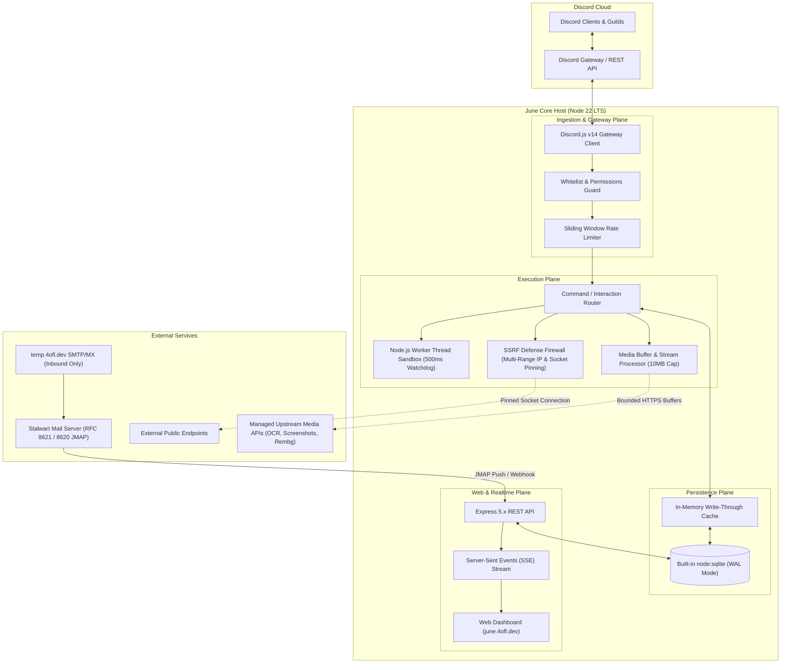
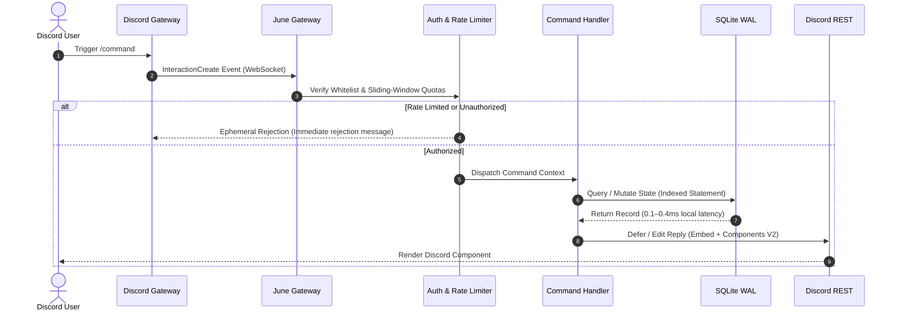

# System Architecture & Runtime Topology

June is an invite-only, security-hardened Discord utility and intelligence platform engineered on **Node.js 22 LTS** and **Discord.js v14**. It is architected for defense-in-depth operational security, low-latency persistence using Node 22's built-in SQLite engine with Write-Ahead Logging (WAL), and real-time event streaming for disposable messaging and diagnostic workflows.

---

## High-Level Topology

The system comprises four primary operational planes:

1. **Ingestion & Gateway Plane**: Manages Discord's WebSocket connection, interaction routing, whitelist authorization, and sliding-window rate limiting.
2. **Core Execution Plane**: Dispatches slash commands, context menus, media forensics, and temporary mailbox workflows. Heavy media and browser tasks are offloaded to external microservices with strict byte and timeout limits.
3. **Persistence Plane**: Operates Node 22's native `node:sqlite` in WAL mode alongside an in-memory write-through cache for hot access keys.
4. **Web & Realtime Plane**: Express 5.x REST API hosting the web dashboard (`june.4ofl.dev`), Server-Sent Events (SSE) streaming, and Stalwart mail webhooks. (WebSocket connections are used exclusively for Discord Gateway communication).

---

## Architectural Principles

### 1. Minimal In-Process Footprint & Decoupled Workloads

- **Baseline Heap Footprint**: The core Node 22 process operates at an idle/standard workload memory baseline of approximately **~100–140 MB RSS**.
- **Decoupled Heavy Operations**: June does **not** embed memory-intensive headless browsers (Chromium/Puppeteer) or local machine-learning models (Tesseract.js OCR, rembg models) inside its primary process. Instead, heavy media tasks are offloaded to dedicated, specialized upstream services:
  - Optical character recognition (`/ocr`) delegates to `api.ocr.space`.
  - Background removal (`/rembg`) delegates to `api.remove.bg`.
  - Webpage screenshots (`/screenshot`) pre-validate target URLs against June's SSRF firewall and delegate rendering to an isolated preview service (`s.wordpress.com/mshots`).
  - Media extraction (`/download`) interfaces with an isolated Cobalt container on an internal Docker bridge.
- **Strict Stream & Buffer Guards**: All media downloads and external API responses enforce a strict **10MB byte ceiling** (`maxBytes`) and an **AbortController timeout (15–20s)**, preventing memory bloat and "decompression bomb" attacks.
- **Production Container Limits**: The production Docker container allocates a **1.5GB memory limit** to comfortably absorb transient buffers, concurrent HTTP streams, and worker thread spawns without triggering out-of-memory (OOM) kernel kills.

### 2. Built-in SQLite Storage & WAL Execution Model

- **Zero Third-Party Native Dependencies**: June uses Node.js 22's built-in `node:sqlite` module (`DatabaseSync`). This eliminates reliance on external C++ npm packages (such as `better-sqlite3`), removing `node-gyp`, Python, and C++ compiler toolchain requirements during deployment and preventing glibc ABI incompatibility issues during Node runtime updates.
- **Synchronous Native Execution**: `node:sqlite` provides synchronous native execution via `DatabaseSync`. Statements execute synchronously on the thread where they are called. Because all June tables maintain primary-key indexes and small record structures, local query latency is measured in **fractions of a millisecond (0.1–0.4ms on NVMe SSD)**, eliminating the event-loop queuing overhead of asynchronous promise wrappers.
- **WAL Read Concurrency**: In Write-Ahead Logging (`PRAGMA journal_mode = WAL`), readers do not block writers, and writers do not block readers. SQLite's shared memory index (`.sqlite3-shm`) allows concurrent reader connections across multiple processes without table-level file locking.
- **Experimental Status in Node 22**: In Node 22 LTS, `node:sqlite` is marked as an experimental built-in feature (requiring `--experimental-sqlite`). June mitigates stability risks through comprehensive test coverage (125+ automated unit tests), atomic database transactions, regular SQLite VACUUM backups, and automated linear schema versioning.

### 3. Multi-Process Cache Coherence

When running across multiple shards or clustered processes:
- **Central ACID State**: The SQLite WAL database file (`june.sqlite3`) serves as the single source of truth for whitelists, configuration, reminders, and temporary mail leases.
- **Shared Memory Synchronization**: SQLite's WAL index file (`.sqlite3-shm`) maps database pages directly into shared memory, ensuring that mutations committed by one shard are immediately visible to subsequent queries across any other shard.
- **Write-Through Invalidation**: Mutations (such as `/admin whitelist add` or `/settings timezone`) commit to SQLite inside an atomic transaction before updating local in-memory caches. Process-local caches use short-lived TTLs (e.g. 60 seconds) to ensure eventual consistency across all running processes without distributed lock managers.

### 4. Defense in Depth & Boundary Hardening

- **Destination-Address Firewall & Socket Pinning**: Outbound HTTP requests pass through an IP-level firewall that resolves targets and blocks private, link-local, carrier-grade NAT, and cloud metadata ranges. Socket connections are pinned directly to validated IPs via custom `lookup` agent hooks, completely eliminating DNS rebinding (TOCTOU) windows.
- **Worker Thread Sandboxing for Regex**: Untrusted regular expressions provided to `/regex` execute inside isolated Node.js `worker_threads` with strict length limits (≤ 256 chars pattern, ≤ 8,000 chars input) and a **500ms software watchdog timer (`worker.terminate()`)** to mitigate ReDoS catastrophic backtracking.

### 5. Ephemeral Mailbox Lifecycle

- **Stateful 60-Minute TTL Leases**: Disposable email addresses allocated via `/tempmail` or the web dashboard are stateful mailboxes bound to a deterministic **60-minute Time-To-Live (TTL)** lease in SQLite (`TEMPMAIL_TTL_SECONDS = 3600`).
- **Storage Boundaries**: Expiring a lease in June unbinds the address, preventing any further user queries. The underlying raw email payloads stored on Stalwart Mail Server are purged in accordance with Stalwart's server-side retention policies.

---

## Interaction Lifecycle Pipeline

When an interaction is triggered via Discord (slash command or message context menu):

1. **Gateway Ingestion**: The interaction event arrives over Discord's WebSocket connection and is parsed by `discord.js`.
2. **Authorization & Rate-Limiting**: Guild and user IDs are validated against June's authorization tables. If unauthorized or rate-limited, June responds with an **immediate ephemeral rejection message** explaining the requirement, terminating execution before invoking command logic.
3. **Execution Routing**: Authorized interactions are dispatched to their specific command module (`src/commands/*`).
4. **Data Access**: If state is required, queries execute synchronously via prepared statements in SQLite WAL mode.
5. **UI Rendering**: Structured response containers are compiled with June's obsidian theme palette (`#050507` surface, `#020202` deep container, `#10b981` emerald accent) and dispatched via Discord's REST API. (Overall command turnaround time of 100–300ms is dominated by Discord REST network latency).

---

## Component Specifications

| Component | Technology | Role |
| :--- | :--- | :--- |
| **Runtime** | Node.js 22 LTS | Asynchronous runtime with V8 JavaScript engine |
| **Discord Interface** | Discord.js v14 | Gateway WebSocket client, interaction router, component builder |
| **Database Engine** | Built-in `node:sqlite` (`DatabaseSync`) | Zero-dependency persistence with Write-Ahead Logging (WAL) and shared memory |
| **Web Server** | Express 5.x REST API | Dashboard backend, Discord OAuth2 authentication, Server-Sent Events (SSE) |
| **Mail Infrastructure** | Stalwart Mail Server (RFC 8621 & 8620 JMAP) | Ephemeral inbox generation & inbound email parsing via HTTPS |
| **Text Recognition** | OCR.space API & Buffer Guards | Upstream OCR text extraction with 10MB streaming caps and 15s timeout aborts |
| **Webpage Previews** | External Rendering Service & SSRF Pre-check | Captures public website previews without running in-process headless Chromium |
| **Background Removal** | remove.bg API & Buffer Guards | Upstream image background removal with credit checks and buffer caps |
| **Media Forensics** | `exif-parser` (Extraction) & `sanitizer.js` (Stripping) | Forensic metadata extraction via `/exif` and automated metadata stripping via `/sanitize` |
| **Documentation UI** | VitePress 1.6 / Vue 3 | Static documentation site deployed to `docs.june.4ofl.dev` |
