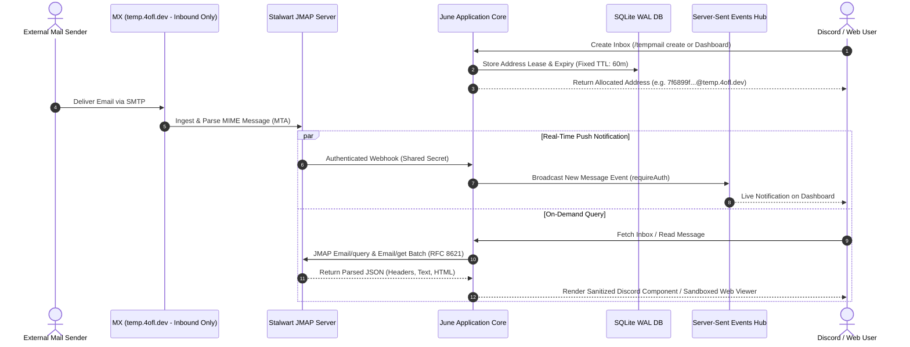

# Ephemeral Disposable Mail Engine (Stalwart JMAP)

June features an integrated ephemeral email platform powered by **Stalwart Mail Server** using modern **JMAP (JSON Meta Application Protocol, RFC 8621 & RFC 8620)**. This architecture replaces legacy IMAP/POP3 polling with efficient, structured JSON-over-HTTPS requests and real-time Server-Sent Events (SSE).

---

## Architectural Workflow



---

## Why JMAP (RFC 8621 & RFC 8620)?

Legacy mail protocols like IMAP require persistent stateful socket connections, expensive bandwidth-heavy synchronization, and complex MIME parsing on the client.

JMAP provides distinct architectural advantages:
1. **JSON Native (RFC 8621)**: Message structures, headers, threading, and mailbox metadata are returned as clean, strongly typed JSON objects without client-side MIME decoding.
2. **Standard TLS HTTPS Transport**: Requests execute over standard HTTPS endpoints (`/jmap/session`), eliminating socket state issues across container restarts and firewalls.
3. **Pipelining & Batching**: Multiple method calls (e.g. `Email/query` followed by `Email/get` using backreferences `#ids`) execute in a single round-trip HTTP request.
4. **Memory Bounded**: Payloads are streamed with strict byte limits (`MAX_JMAP_RESPONSE_BYTES = 2MB`), preventing memory exhaustion.

---

## Ingestion & Lifecycle Management

### 1. Ephemeral Address Allocation & SQLite Leases

When an inbox is created via `/tempmail create` or the web dashboard:
- A cryptographically randomized address is generated: `<hex>@temp.4ofl.dev`.
- A **deterministic 60-minute Time-To-Live (TTL)** (`TEMPMAIL_TTL_SECONDS = 3600`) is recorded in SQLite alongside the owning Discord user ID.
- Inboxes are stateful during their active 60-minute lifecycle: messages, read states, and headers are queried dynamically for the owner.
- Inboxes are strictly isolated: only the owning Discord user (or authenticated dashboard session) can view incoming messages.

### 2. Message Querying (`Email/query` and `Email/get`)

To fetch messages for an address, June's JMAP client (`src/utils/tempmail.js`) first queries the JMAP session endpoint (`/jmap/session`) to extract the resolved primary account ID (`session.primaryAccounts['urn:ietf:params:jmap:mail']`), and then constructs a batched JMAP invocation:

```json
{
  "using": ["urn:ietf:params:jmap:core", "urn:ietf:params:jmap:mail"],
  "methodCalls": [
    [
      "Email/query",
      {
        "accountId": "<resolved_account_id>",
        "filter": { "to": "7f6899f3a1@temp.4ofl.dev" },
        "sort": [{ "property": "receivedAt", "isAscending": false }],
        "limit": 10
      },
      "call-0"
    ],
    [
      "Email/get",
      {
        "accountId": "<resolved_account_id>",
        "#ids": {
          "resultOf": "call-0",
          "name": "Email/query",
          "path": "/ids"
        },
        "properties": ["id", "blobId", "threadId", "from", "to", "subject", "receivedAt", "preview", "hasAttachment"]
      },
      "call-1"
    ]
  ]
}
```

The server evaluates the query and returns matching email headers in a single atomic response.

### 3. Expiry vs Storage Boundary

It is important to understand the boundary between June's SQLite lease and Stalwart's storage:
- **June SQLite Lease Expiry**: After 60 minutes, the address lease in SQLite expires. June's cleanup routine unbinds the address, and the bot/dashboard will refuse to query or expose messages for that address.
- **Stalwart Server Storage**: The underlying MIME emails and raw message bodies stored on Stalwart Mail Server are subject to Stalwart's server-side retention policies and scheduled administrative purge tasks. Expiring a lease in June removes access to the address, while Stalwart manages low-level storage lifecycle.

---

## Abuse Prevention & Security

### 1. Inbound MX Only (No Outbound Relaying)
Stalwart Mail Server is configured exclusively as an **inbound MX receiver** for `temp.4ofl.dev`. Outbound SMTP relaying is completely disabled. June cannot be abused as an open relay to transmit spam, phishing emails, or unsolicited bulk messages.

### 2. Anti-Spoofing DNS Configuration
To prevent adversaries from sending forged emails pretending to originate from `@temp.4ofl.dev`:
- **SPF**: `v=spf1 -all` (strictly rejects all outbound sending IPs).
- **DMARC**: `v=DMARC1; p=reject` (instructs receiving mail servers to reject unauthorized mail).

### 3. HTML Sanitization & XSS Defense
When displaying email contents:
- **Discord Client**: Embeds and text components display sanitized plain-text summaries with hyperlinks defanged.
- **Web Dashboard**: HTML email bodies are isolated inside sandboxed `<iframe>` containers with script execution disabled (`sandbox="allow-popups"` with `allow-scripts` stripped) and protected by Content Security Policy.
- **Attachment Ceilings**: Attachments exceeding 10MB are blocked from previewing to protect client and server memory.
