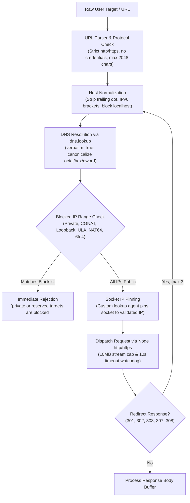
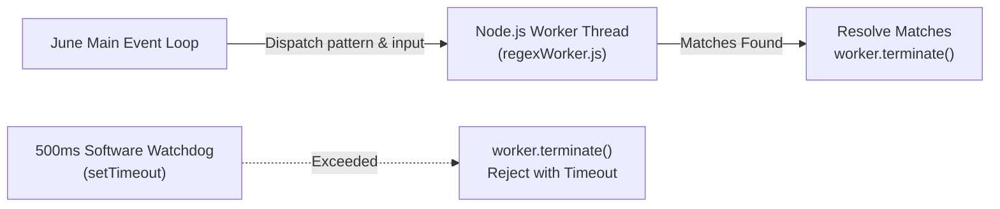

# Security Architecture & Hardening

June is designed around **defense-in-depth** and **strict boundary enforcement**. All inputs from Discord users, external URLs, network queries, and incoming mailstreams are treated as untrusted and validated against multi-stage firewalls, isolated worker threads, and memory caps.

---

## 1. Outbound Network Firewall & SSRF Defense

Any command that initiates an outbound network request (URL previews, webpage screenshots, metadata inspection, sentinel probes) routes through June’s dedicated network firewall (`src/utils/network.js`).

### Multi-Stage Validation Pipeline



### Complete Range Enforcement

The firewall evaluates resolved IP addresses against private, link-local, documentation, carrier-grade, and reserved ranges:

#### IPv4 Range Blocklist
- `0.0.0.0/8` — Current network / default route (strictly blocked to prevent accessing `0.0.0.0` which resolves to localhost on Linux systems)
- `10.0.0.0/8` — RFC 1918 Private address space
- `100.64.0.0/10` — RFC 6598 Carrier-Grade NAT (CGNAT) / Shared address space
- `127.0.0.0/8` — Loopback interfaces (`127.0.0.1` – `127.255.255.254`)
- `169.254.0.0/16` — Link-local network (including cloud instance metadata `169.254.169.254`)
- `172.16.0.0/12` — RFC 1918 Private address space
- `192.0.0.0/24` — IETF Protocol Assignments
- `192.0.2.0/24`, `198.51.100.0/24`, `203.0.113.0/24` — TEST-NET-1, TEST-NET-2, TEST-NET-3 documentation ranges
- `192.168.0.0/16` — RFC 1918 Private address space
- `198.18.0.0/15` — Benchmarking / device interconnect subnets
- `224.0.0.0/4` — Multicast (Class D)
- `240.0.0.0/4` — Reserved for future use (Class E)

#### IPv6 Range Blocklist
- `::/128` — Unspecified address
- `::1/128` — Loopback interface
- `fc00::/7` — RFC 4193 Unique Local Addresses (ULA)
- `fe80::/10` — Link-local unicast
- `ff00::/8` — Multicast
- `2001:db8::/32` — Documentation subnet
- `::ffff:0:0/96` — IPv4-mapped IPv6 (the embedded IPv4 address is extracted and inspected against all IPv4 rules)
- `64:ff9b::/96` — Well-Known Prefix for NAT64 (the embedded IPv4 address is extracted and inspected against all IPv4 rules)
- `2002::/16` — 6to4 encapsulation prefix (the embedded IPv4 address in bits 16..48 is extracted and inspected against all IPv4 rules)

### Handling Non-Standard IPv4 Notations

Adversaries often attempt SSRF bypasses using non-standard IP representations (e.g., octal `0177.0.0.1`, hexadecimal `0x7f000001`, or DWORD integer `2130706433`). 

June handles this by resolving all hostname inputs via Node’s system resolver `dns.lookup` with `{ all: true, verbatim: true }`. The operating system resolver canonicalizes non-standard numerical formats into standard dotted-decimal IPv4 records before the range inspection runs. If canonicalization fails or resolves to any blocked address, the connection is aborted immediately.

### Socket IP Pinning (Eliminating DNS Rebinding / TOCTOU)

A common vulnerability in naive SSRF filters is "validate-then-connect" Time-of-Check to Time-of-Use (TOCTOU). An attacker configures a DNS record with a low TTL (0–1s) that initially resolves to a public IP to pass validation, and then immediately re-resolves to an internal IP (such as `127.0.0.1` or `169.254.169.254`) when the HTTP client establishes its socket.

June eliminates this vulnerability by **pinning the socket connection directly to the pre-validated IP address**:

```js
const request = transport.request({
    protocol: target.url.protocol,
    hostname: target.url.hostname,
    port: target.port,
    path: `${target.url.pathname}${target.url.search}`,
    headers: { ...options.headers },
    // Force the socket to connect directly to the pre-validated IP:
    lookup: (_hostname, _lookupOptions, callback) => callback(null, target.address, target.family),
    agent: false
});
```

Because `lookup` is overridden, the underlying Node TCP socket connects directly to `target.address` without performing a second DNS query, while preserving the requested HTTP `Host` header and TLS SNI `servername`. Every redirect hop re-runs full validation and repins the destination socket.

### Webpage Screenshot & Headless-Browser SSRF Containment

Headless browsers (such as Puppeteer or Playwright) represent a significant SSRF attack surface because modern web pages automatically initiate secondary subresource requests (images, stylesheets, scripts, `fetch()` calls) and follow client-side redirects that bypass standard application-level HTTP wrappers.

To protect against this:
1. June does **not** run an in-process headless Chromium instance inside the application container.
2. The `/screenshot` command runs target URLs through `normalizeHttpUrl()` and `validatePublicHttpTarget()` to verify that the destination is a public HTTP/HTTPS host.
3. Once validated, June delegates webpage rendering to an isolated external screenshot service (`s.wordpress.com/mshots/v1/`).
4. This architecture completely decouples June’s local network interfaces from browser engine rendering loops, subresource requests, and headless browser sandbox escape vulnerabilities.

### Port Policy & Documented Exceptions
- **General HTTP Pipeline**: Strictly restricts outbound ports to **80** (HTTP) and **443** (HTTPS). Non-standard ports (e.g. `8080`, `3000`, `6379`, `22`) are rejected at the normalization layer.
- **Specialized Diagnostic Exceptions**:
  - `/minecraft server`: Queries Minecraft server statuses. Instead of making raw socket connections, June queries the dedicated status API `api.mcsrvstat.us`, allowing arbitrary Minecraft ports without opening internal network holes.
  - `/portscan`: An administrator-only diagnostic tool that conducts probe-limited TCP socket connections across a fixed set of 11 common ports against public hosts, with mandatory SSRF IP validation and explicit authorization confirmation.

---

## 2. ReDoS Mitigation & Worker Thread Sandboxing

Regular expression denial of service (ReDoS) occurs when malicious input forces an engine with exponential or polynomial backtracking into catastrophic recursion, locking the Node.js event loop.

June mitigates ReDoS using isolated Node.js `worker_threads` (`src/utils/runRegex.js`):



### Sandbox Safeguards:
- **Length Caps**: Patterns are limited to **≤ 256 characters**; test inputs are limited to **≤ 8,000 characters**.
- **Flag Sanitization**: Only valid standard regex flags (`dgimsuvy`) without duplicates are permitted.
- **Thread Isolation**: Pattern execution occurs in a separate Node.js worker thread, protecting the main event loop.
- **500ms Software Watchdog**: If evaluation exceeds 500ms, the worker thread is terminated via `worker.terminate()`, preventing thread starvation.

---

## 3. Cryptographic Timing-Safe Comparisons

To eliminate side-channel timing leaks when verifying administrative tokens, webhook secrets, and session cookies, June uses HMAC-then-compare cryptographic routines (`crypto.timingSafeEqual`):

```js
function constantTimeCompare(a, b) {
    if (typeof a !== 'string' || typeof b !== 'string') return false;
    const key = crypto.randomBytes(32);
    const hmacA = crypto.createHmac('sha256', key).update(a).digest();
    const hmacB = crypto.createHmac('sha256', key).update(b).digest();
    return crypto.timingSafeEqual(hmacA, hmacB);
}
```

By hashing both inputs with an ephemeral HMAC key before comparing, the comparison is performed over uniform 32-byte digests. This eliminates both character-by-character timing variances and input length leaks.

---

## 4. Abuse Prevention & Platform Threat Model

Beyond protecting June from external attacks, June's threat model actively guards against the abuse *of* June's diagnostic and ephemeral tooling by malicious actors.

### 1. Diagnostic Network Probing (`/portscan`)
To prevent June from being weaponized as a distributed port scanning bot:
- **Strict Role Gating**: Gated exclusively to bot operators and administrators (`access: 'admin'`).
- **Explicit Authorization Flag**: Requires the caller to explicitly pass `authorized: true` to confirm testing permission.
- **SSRF Range Check**: Destination hosts are evaluated via `resolvePublicHost()`; private, loopback, and cloud metadata targets are rejected.
- **Probe-Bounded Execution**: Restricted to a fixed array of 11 common diagnostic ports (21, 22, 25, 53, 80, 110, 143, 443, 3306, 3389, 8080) with a 1500ms timeout per probe. June does not support arbitrary port ranges or high-volume SYN flooding.

### 2. Disposable Mail Domain Reputation (`temp.4ofl.dev`)
Public disposable mail domains frequently suffer from IP reputation blacklisting and abuse as spam relay targets.
- **Inbound MX Only**: Stalwart Mail Server is configured exclusively as an inbound MX receiver. Outbound SMTP relaying is completely disabled, preventing June from ever being used to transmit spam or phishing emails.
- **Anti-Spoofing DNS Records**: The `temp.4ofl.dev` zone publishes strict SPF records (`v=spf1 -all`) and DMARC reject policies (`p=reject`) to ensure third parties cannot spoof emails claiming to originate from June's mail domain.
- **Ephemeral 60-Minute Leases**: Inboxes expire automatically after 60 minutes, with expired bindings purged from SQLite.

### 3. Untrusted Email HTML & XSS Mitigation
Emails received via `temp.4ofl.dev` may contain malicious HTML, tracking pixels, or cross-site scripting (XSS) payloads.
- **Scrubbing & Defanging**: Incoming email bodies rendered in Discord embeds are sanitized: all script tags, event handlers (`onload`, `onerror`), and external iframe tags are stripped.
- **Sandboxed Web Viewer**: On the web dashboard, email HTML is isolated in sandboxed iframes configured without script execution privileges (`sandbox="allow-popups"` with `allow-scripts` stripped).
- **Dashboard Content Security Policy**: The dashboard enforces a strict CSP that blocks unauthorized inline script evaluation and restricts object/frame sources.

### 4. SSE Stream & Webhook Authentication
- **Dashboard Real-Time Streaming**: The Server-Sent Events stream (`GET /api/dashboard/events`) is authenticated via signed session cookies (`__Host-june_session`). Unauthenticated callers are rejected with HTTP 401.
- **Stalwart Push Webhooks**: Inbound notifications from Stalwart Mail Server require a pre-shared secret token verified via constant-time comparison before emitting events to the SSE hub.

### 5. Dashboard CSRF & Session Security
- **OAuth2 State Nonces**: The Discord OAuth2 login flow generates a 24-byte cryptographically random state nonce stored in a short-lived (5-minute), HttpOnly, SameSite=Lax cookie. Returned states are compared using timing-safe comparisons.
- **Host-Prefixed Cookies**: In production, session tokens use the `__Host-` cookie prefix, ensuring cookies cannot be overwritten from subdomains and are transmitted only over HTTPS connections.

### 6. Discord Interaction Verification
- **Gateway TLS Framing**: Standard slash commands and context menus are ingested over Discord’s encrypted WebSocket connection, eliminating payload tampering.
- **HTTP Interactions**: If June is configured for Discord HTTP Interactions, incoming webhooks verify Discord’s `Ed25519` cryptographic signatures (`X-Signature-Ed25519` and `X-Signature-Timestamp`) using the application public key before parsing request bodies.

---

## 5. Media Forensics vs Image Sanitization

June clearly delineates between **forensic metadata extraction** and **metadata stripping**:

- **Metadata Extraction (`/exif`)**: A diagnostic command that parses embedded metadata (EXIF, IPTC, GPS coordinates, camera serial numbers) from user-supplied image attachments for forensic investigation. Extracted metadata is formatted into an ephemeral Discord container and is never persisted into June's database.
- **Metadata Stripping (`/sanitize`)**: A privacy-preserving utility that parses JPEG (APP1/EXIF segments) and PNG (tEXt, eXIf chunks) images, stripping tracking tags, device identifiers, and geolocation headers before returning a clean image file.

---

## 6. Legal Boundaries, Lawful OSINT & Evidentiary Disclaimers

The intelligence and reconnaissance tools provided by June (`/breach`, `/telegram`, `/reddit`, `/lens`, `/whois`, `/evidence`) are engineered under strict legal and compliance boundaries:

1. **Public Information Boundaries**: Commands query publicly accessible APIs and search engine indices. June does not bypass authentication paywalls, scrape private Discord channels, or access non-public databases.
2. **Breach Intelligence**: `/breach` checks public breach notification indexes to determine whether an email identifier appears in historical breach lists. It does not store, index, or expose plain-text passwords or credential dumps.
3. **Evidentiary Disclaimer (`/evidence`)**: The `/evidence` command collects a snapshot bundle of public technical indicators (HTTP response headers, DNS resolution records, TLS certificates, and SHA-256 body hashes) for point-in-time debugging and verification. **This technical bundle does not constitute a certified legal forensic artifact for evidentiary submission in court jurisdictions and carries no statutory warranty of legal admissibility.**
4. **GDPR Data Subject Sovereignty**: Users retain complete sovereignty over their data with self-service `/data view`, `/data export`, and permanent atomic `/data delete` commands directly within Discord.
