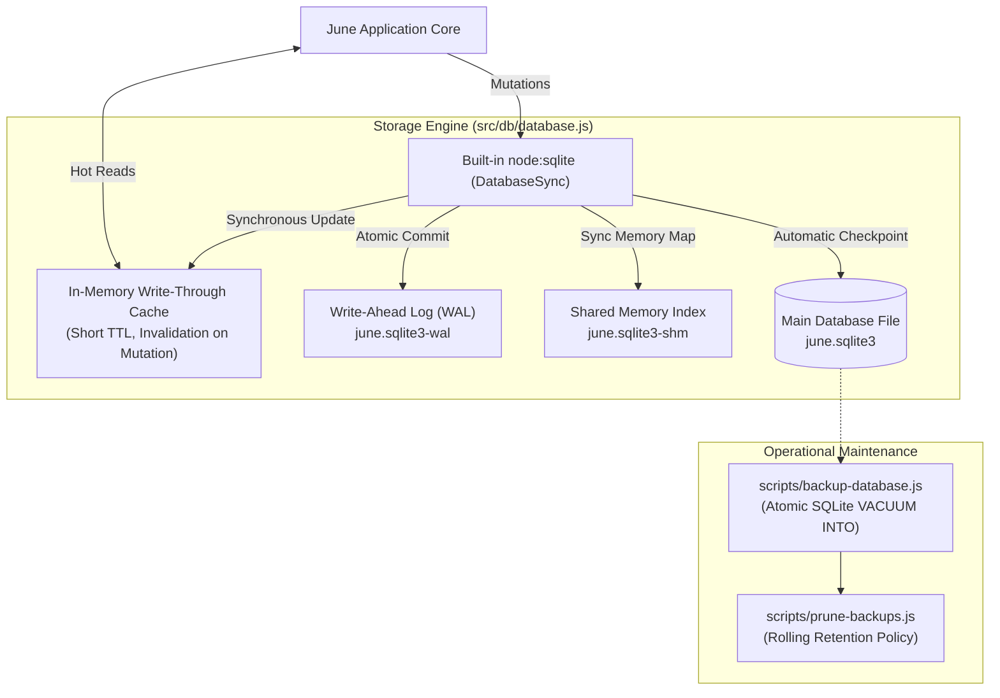
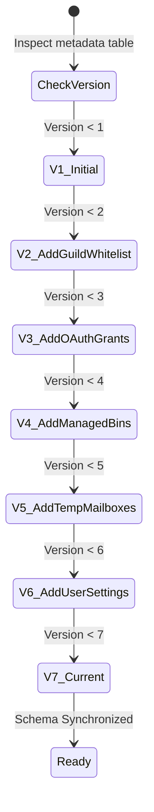

# SQLite Storage Engine & Persistence Architecture

June utilizes the built-in `node:sqlite` engine (`DatabaseSync`) introduced in **Node.js 22 LTS**. By leveraging Node's native built-in SQLite implementation, June eliminates third-party npm native compilation toolchains (e.g. `node-gyp`, Python, and C++ compilers), achieving reproducible container builds, zero-dependency deployments, and direct V8 native execution.

---

## Storage Architecture Overview

All bot persistent state—including guild authorizations, OAuth tokens, temporary mail leases, custom bins, receipts, and user preferences—is maintained in a centralized SQLite database (`src/db/database.js`).



---

## Execution Model & Performance Realities

### Synchronous Native Execution (`DatabaseSync`)

The built-in Node 22 SQLite module operates synchronously via `DatabaseSync`. Prepared statements (`statement.get()`, `statement.all()`, `statement.run()`) execute synchronously on the Node.js thread where they are called.

#### Architectural Rationale:
1. **Microsecond Latency**: Because June's schema is normalized and indexed on primary keys (e.g. `user_id`, `guild_id`, `slug`), single-row lookups execute in **fractions of a millisecond (0.1–0.4ms on NVMe SSDs)**.
2. **Zero Event-Loop Queuing Overhead**: For microsecond queries, the overhead of allocating Promises, queuing microtasks, and dispatching libuv threadpool workers exceeds the actual database execution time. Synchronous native execution eliminates this overhead.
3. **Turnaround Time Context**: Discord interaction deadlines allow up to 3,000ms before requiring an initial response. An internal query taking 0.2ms represents less than 0.1% of the total round-trip, which is almost entirely governed by Discord REST API network latency (100–300ms).

### Concurrency in WAL Mode

While queries on a single database handle are synchronous within that thread, June operates with Write-Ahead Logging (`PRAGMA journal_mode = WAL`):
- **Non-Blocking Readers**: Readers do not block writers, and writers do not block readers.
- **Concurrent Cross-Process Readers**: Multiple worker threads or sharded processes can read from the database concurrently without database-level file locks.
- **Single-Writer Safety**: Writes are serialized at the WAL log level with a `PRAGMA busy_timeout = 5000` retry window to prevent lock contention under burst workloads.

### Experimental Status in Node 22

In Node 22 LTS, `node:sqlite` is marked as an experimental built-in feature (requiring the `--experimental-sqlite` runtime flag). June accepts this trade-off to avoid third-party native compilation toolchains (such as `better-sqlite3`), which frequently encounter native compilation breakages across Node engine updates. Stability is safeguarded through:
- **Comprehensive Test Suite**: Over 125 automated unit tests covering all queries, transactions, and concurrency patterns.
- **Atomic Transactions**: All mutations and schema migrations run inside explicit SQLite transactions (`withTransaction`), guaranteeing clean rollbacks upon error.
- **Online Non-Blocking Backups**: Live database backups via `VACUUM INTO`.

---

## Core Pragma Tuning & Durability Trade-offs

On initialization, June configures high-throughput SQLite pragmas:

```sql
PRAGMA foreign_keys = ON;
PRAGMA journal_mode = WAL;
PRAGMA synchronous = NORMAL;
PRAGMA busy_timeout = 5000;
PRAGMA wal_autocheckpoint = 1000;
PRAGMA temp_store = MEMORY;
```

### Durability & Performance Analysis:

1. **`journal_mode = WAL` (Write-Ahead Logging)**:
   - Changes are appended sequentially to `june.sqlite3-wal`, avoiding in-place database modifications during active transactions.
2. **`synchronous = NORMAL` (The Durability Trade-off)**:
   - In WAL mode, `NORMAL` guarantees data integrity across application crashes while omitting expensive physical disk `fsync` calls on every individual commit.
   - **Trade-off:** In the event of a sudden operating system crash or physical host power failure, transactions committed to the WAL file since the last operating system disk sync may be lost. For a Discord utility and intelligence platform, this is an intentional, optimal trade-off prioritizing sustained high write throughput over absolute power-loss durability.
3. **`busy_timeout = 5000`**:
   - Instead of throwing immediate `SQLITE_BUSY` errors during write bursts, statements retry automatically for up to 5,000ms until the write lock clears.
4. **`temp_store = MEMORY`**:
   - Temporary tables, sorting buffers, and transient indexes reside strictly in RAM, preventing disk I/O bottlenecks.

---

## Multi-Process Cache Coherence

When running June in sharded or clustered mode (`cluster.js`):

1. **Single Source of Truth**: All shard processes mount and open the shared SQLite database file (`june.sqlite3`) in WAL mode.
2. **Shared Memory WAL Index (`.sqlite3-shm`)**: SQLite maintains a shared-memory index file that coordinates page access across multiple processes on the same host. When Shard A commits a mutation (e.g. adding a whitelisted user or updating preferences), the WAL index is updated in shared memory, making the committed data immediately visible to Shard B without stale database reads.
3. **Write-Through Cache Invalidation**: In-memory caching layers (such as `userPreferences` and whitelist lookups) use write-through updates: mutations write to SQLite first, then invalidate the local cache. Process-local caches use short-lived TTLs (e.g. 60 seconds) to ensure eventual consistency across all running processes without distributed lock managers.

---

## Schema & Migration Strategy

June employs a linear migration pipeline governed by `SCHEMA_VERSION`:

```js
const SCHEMA_VERSION = 7;
```

When June boots, it checks the `metadata` table for the current `schema_version`. If the database is newly initialized or lagging behind the application build, incremental migration transactions execute atomically:



All schema upgrades run inside transactions: if any migration statement encounters an anomaly, the transaction rolls back cleanly, preventing database corruption.

---

## Automated Backup & Disaster Recovery

Data safety is maintained via automated snapshotting:

1. **Zero-Lock Backups**: Utilizing SQLite's native `VACUUM INTO 'backup-path.sqlite3'` statement, backups are taken live without blocking active reads or writes.
2. **Rolling Retention**: Backups older than the retention threshold (e.g., 7 days) are pruned automatically via scheduled maintenance tasks (`scripts/prune-backups.js`).
