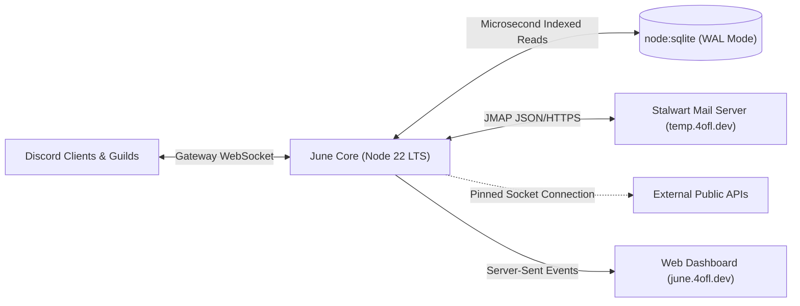

<LiveTelemetry />

## What is June?

**June** is a private, security-hardened Discord application built for technical teams, security researchers, and Discord power users. Rather than providing generic moderation or entertainment features, June delivers low-latency developer utilities, network diagnostics, forensic media inspection, and private temporary email inboxes.

---

## Who is June For?

June is maintained as an **invite-only, whitelisted application**. Because June provides network diagnostic tools (such as `/portscan` and `/site`), forensic utilities, and inbound email infrastructure (`temp.4ofl.dev`), access is restricted to authorized servers and whitelisted users to prevent platform abuse, network scanning spam, and server reputation degradation.

- **Whitelisted Users**: Authorized accounts can invoke June's complete toolset in direct messages (DMs) or within any server where user apps are enabled.
- **Authorized Communities**: Servers invited via locked invitation links receive server-wide access to safe utilities and developer tools.
- **Bot Operators & Administrators**: Privileged diagnostic commands (such as `/portscan` and administrative configuration) are restricted to verified operators with explicit authorization confirmations.

> [!TIP]
> Ready to onboard or invite June to your account? Read the **[Getting Started & Access Guide](/commands/getting-started)**.

---

## Architecture at a Glance

June is engineered on **Node.js 22 LTS** and **Discord.js v14**, operating on dedicated infrastructure with a minimal footprint:

1. **Ingestion & Gateway Plane**: Connects to Discord's Gateway via WebSockets, authenticates callers against an in-memory whitelist, and enforces sliding-window rate limits.
2. **Execution Plane**: Dispatches slash commands and context menus with strict input validation. CPU-intensive operations (such as regex evaluation) run in isolated worker threads with 500ms software timers. Heavy media tasks (such as OCR, background removal, and webpage screenshots) are offloaded to specialized external microservices with strict 10MB buffer limits.
3. **Persistence Plane**: Operates Node.js 22's built-in `node:sqlite` in Write-Ahead Logging (WAL) mode, delivering sub-millisecond local queries without requiring external C++ build toolchains (`node-gyp`).
4. **Web & Realtime Plane**: An Express 5 REST API hosting the web dashboard (`june.4ofl.dev`), Discord OAuth2 session verification, and Server-Sent Events (SSE) streaming for real-time mailbox updates.

---

## Key Design Principles

- **No Third-Party Native Build Dependencies**: By leveraging Node 22's built-in `node:sqlite`, June eliminates npm native compilation steps, ensuring reproducible container builds and zero glibc ABI mismatch issues.
- **Strict Boundary Defense**: All outbound requests resolve IP addresses and pin sockets directly to validated public destinations, eliminating DNS rebinding (TOCTOU) risks.
- **User Data Sovereignty**: All stored user state (reminders, saved receipts, preferences, tempmail leases) can be inspected via `/data view`, downloaded via `/data export`, or permanently erased via `/data delete`.

