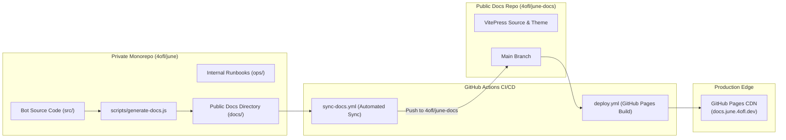
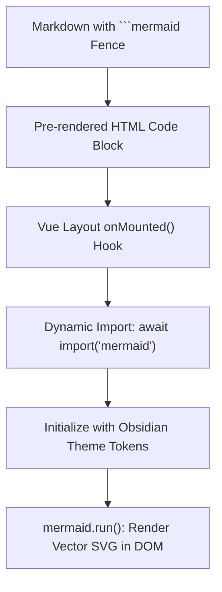

# Documentation Platform Architecture

The June documentation platform ([docs.june.4ofl.dev](https://docs.june.4ofl.dev/)) is engineered as a decoupled static documentation site powered by **VitePress 1.6**, GitHub Actions, and an automated synchronization pipeline.

> [!NOTE]
> This page describes the technical architecture of the **documentation website** itself. For the bot application runtime, Discord gateway, SQLite persistence, and security firewall, see **[System Topology & Core Runtime](/architecture/)**.

---

## Decoupled Architecture

To protect proprietary operational workflows, private administrator tooling, and internal infrastructure configurations, the documentation product is decoupled into two repositories:

### 1. `4ofl/june` (Private Engine)
- Contains bot application code, native SQLite database logic, and internal operational runbooks (`ops/`).
- Owns the documentation **contract** and generates command reference specifications directly from Discord slash command builders (`scripts/generate-docs.js`).
- The `sync-docs.yml` workflow synchronizes only the sanitized `docs/` tree to the public repository upon pushes to `main`.

### 2. `4ofl/june-docs` (Public Documentation Platform)
- Standalone documentation product hosted as an open-source reference.
- Excludes bot tokens, internal compose setups, management guild IDs, and administrator commands.
- Compiles via VitePress and deploys to the custom domain `https://docs.june.4ofl.dev/`.

---

## Static Site Generation & Theming

### 1. Engine: VitePress 1.6
June's documentation runs on VitePress, Vue 3, and Vite:
- Client-side routing with pre-fetched page transitions.
- Build-time Server-Side Rendering (SSR) emitting lightweight, accessible HTML.
- Built-in local full-text search with zero external tracking scripts.
- Automated XML sitemap generation for search engine indexing (`/sitemap.xml`).

### 2. Obsidian Design System Palette
The documentation styling mirrors June's Discord embed aesthetic and dashboard palette:
- **Deep Base**: `#020202` (deepest contrast background for code blocks and root canvas).
- **Obsidian Surface**: `#050507` (viewport theme-color and primary content card surface).
- **Component Borders**: `rgba(255, 255, 255, 0.08)` (subtle structural separation).
- **Emerald Accent**: `#10b981` (focused links, badge accents, and primary action buttons).
- **Typography**: Space Grotesk for headings, Inter for body copy, and JetBrains Mono for code blocks.

---

## Dynamic Vector Diagramming (Mermaid)

VitePress renders standard code blocks by default. June integrates an SSR-safe, client-side dynamic Mermaid diagramming engine in `docs/.vitepress/theme/Layout.vue`:

- **SSR-Safe**: Dynamic importing (`await import('mermaid')`) prevents server-side rendering crashes during static site compilation.
- **Theme Reactivity**: A Vue watcher observes `isDark` changes and re-renders SVG diagrams to adapt stroke colors and node contrast.

---

## SEO, Canonical Links & Metadata

Every page on `docs.june.4ofl.dev` automatically generates comprehensive search engine metadata:
- **Canonical URLs**: Dynamically generated canonical links pointing to `https://docs.june.4ofl.dev/<page>/`.
- **OpenGraph & Twitter Cards**: Formatted per page with explicit page titles, descriptions, and site names.
- **Sitemap**: Clean XML sitemap emitted at `/sitemap.xml` on every build.
- **Last Updated Timestamps**: Git commit timestamps enabled via `fetch-depth: 0` in GitHub Actions.
